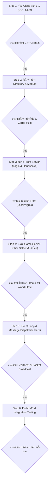

# แผนงานการพอร์ต C++ GoonZu Client สู่ Rust (1-1 OOP Architecture)

> [!IMPORTANT]
> ### 🛡️ กฎเหล็กและข้อกำหนดการทำงาน (Core Governance Rules)
> 1. **การทวนสอบทุกขั้นตอน (Verification First):**
>    ในทุกขั้นตอน **ต้องทำการทวนสอบ (Verification & Validation)** เทียบกับ Source Code C++ ต้นฉบับ (`GoonZuWorld/Client`) และ Protocol จริงของเซิร์ฟเวอร์ (`rust_Iwcgz_server`) พร้อมรันเทสผลลัพธ์จริง **ก่อนทำการยืนยัน (Confirm) เพื่อปิดสเต็ปเสมอ** ห้ามข้ามขั้นตอนโดยไม่มีการทวนสอบ
> 2. **แผนงานยืดหยุ่น งอกสเต็ปย่อยได้เสมอ (Dynamic Sub-steps):**
>    แผนงานสามารถแตกเป็นสเต็ปย่อย (`Step X.1`, `Step X.2`, ...) ได้ตลอดเวลาเมื่อพบรายละเอียดหน้างานเพิ่มเติม เพื่อให้การทำงานรอบคอบ ไม่หลงทาง และไม่คิดเยอะจน Overengineer
> 3. **เมื่อเกิดปัญหา ต้องทำ RCA & Full Report (Incident RCA Protocol):**
>    หากพบ Bug, Compile Error, Protocol Mismatch หรือการเชื่อมต่อไม่เป็นไปตามคาด **ต้องหยุดวิเคราะห์หาสาเหตุที่แท้จริง (Root Cause Analysis - RCA)** และจัดทำ **Full Report** (สาเหตุ กลไกที่พลาด วิธีแก้ และการป้องกัน) บันทึกไว้อย่างเป็นทางการก่อนดำเนินการต่อ
> 4. **การควบคุมเอกสารชัดเจน ห้ามซ่อนไฟล์ (Document Control Policy):**
>    เอกสาร รายงาน แผนงาน และบันทึกข้อกำหนดทั้งหมด **ต้องจัดเก็บไว้ในตำแหน่งที่เปิดเผย ชัดเจน เข้าถึงง่าย** (เช่น Root / โฟลเดอร์ `docs/` ที่เห็นได้ทันที) **ห้ามสร้างหรือซ่อนไฟล์เอกสารไว้ในโฟลเดอร์ย่อยลึกๆ หรือซ่อนไว้ตามหลืบของโค้ดเด็ดขาด**

---

## 📌 สรุปเป้าหมาย
พอร์ต GoonZu Client จาก C++ สู่ Rust โดยใช้โครงสร้างแบบ **OOP 1-1** ล้อตามคลาสและโฟลเดอร์เดิมของ C++ แทนการเขียนแบบ Script ทางเดียว เพื่อให้เป็น Client ที่มี State Machine, Event Dispatcher และโครงสร้างที่เข้าใจง่าย ขยายต่อได้จริง

---

## 🧭 ลำดับขั้นตอนการดำเนินงาน (Step-by-Step Plan)

*(หมายเหตุ: แต่ละ Step สามารถแตกแขนงเป็น Step X.1, X.2 ได้ตามความจำเป็นของหน้างาน)*

---

### **Step 1: จับคู่ Class หลัก 1-1 (OOP Core Mapping)**
- แมปปิ้ง Struct ใน Rust ให้มีชื่อ ขอบเขตหน้าที่ และ Data Layout สอดคล้องกับ Class เดิมของ C++:
  1. `cltClient` (`Client.h` / `Client.cpp`): คลาสหลักผู้ถือ State รวมทั้งหมด
  2. `cltStateBox` (`Network/StateBox.h`): ตัวคุมสถานะการเชื่อมต่อและเกม (State Machine)
  3. `cltWorldList` & `WORLDINFO` (`WorldList.h`): รายการ World Server
  4. `ITZNetOverlapped` / `ITZSession` (`NetworkLib/ITZNetLib`): ตัวจัดการ Network Socket, Cipher, Send/Recv
  5. `cltCharClient` (`Char/CharClient/Char-Client.h`): ข้อมูลตัวละครของผู้เล่น
- **เกณฑ์การทวนสอบก่อนยืนยัน:**
  - ตรวจสอบ Memory Layout, Field Name และความรับผิดชอบของแต่ละ Struct เทียบกับไฟล์ Header (`.h`) ของ C++ แบบบรรทัดต่อบรรทัด

---

### **Step 2: จัดโครงสร้าง Directory & Module (Project Layout 1-1)**
- จัดโครงสร้างโฟลเดอร์ใน `src/` ให้ตรงกับโครงสร้าง C++:
  - `src/client/` : `clt_client.rs`, `state_box.rs`, `client_login.rs`
  - `src/network/`: `net_session.rs`
  - `src/world/`  : `world_list.rs`
  - `src/char/`   : `char_client.rs`
  - `src/config.rs`: ตั้งค่า Endpoints (รองรับ Localhost และ Ngrok Tunnel)
- **Document Control ในตัวโปรเจกต์:**
  - จัดวางเอกสารในระดับ Root / โฟลเดอร์ `docs/` ที่ระดับบนสุดเท่านั้น ไม่ซ่อนตามโฟลเดอร์ย่อย
- **เกณฑ์การทวนสอบก่อนยืนยัน:**
  - รัน `cargo check` / `cargo build` โครงสร้างโปรเจกต์ต้องคอมไพล์ผ่าน ไม่มี dependency ขัดแย้ง

---

### **Step 3: พอร์ตระบบ Login & Handshake (Phase 1: Front Server)**
- เทียบเคียงโค้ดจาก `Client-Login.cpp`:
  1. `cltClient::ConnectFront()` ต่อไปที่ Port `5700` (หรือ Ngrok `0.tcp.ap.ngrok.io:11853`)
  2. รับ `RESPONSE_SECRETKEY` (30000) $\to$ ติดตั้ง Cipher Key
  3. ส่ง `REQUEST_ENGLISH_LOGIN` (21) $\to$ รับ `RESPONSE_LOGIN` (1000)
  4. ส่ง `REQUEST_WORLDLIST` (3) $\to$ รับ `RESPONSE_WORLDLIST` (1002) เก็บลง `clWorldList`
  5. ปิด Session Front เพื่อเตรียมสลับไป Game Server
- **เกณฑ์การทวนสอบก่อนยืนยัน:**
  - รันเชื่อมต่อ Front Server จริง ผลการ Login สำเร็จและได้ข้อมูล World List ถูกต้องตรงตาม Wire Format

---

### **Step 4: พอร์ตระบบ Character Select & เข้าโลก (Phase 2: Game Server)**
- เทียบเคียงโค้ดจาก `Client-Login.cpp` & `Client-ServerReturn.cpp`:
  1. `cltClient::ConnectGame()` ต่อไปที่ Port `4010` (หรือ Ngrok `0.tcp.ap.ngrok.io:27911`)
  2. รับ Handshake Key จาก `RESPONSE_CLIENTCHARUNIQUE` (1)
  3. ส่ง `REQUEST_LOGIN` (2)
  4. รับ `RESPONSE_CHARLIST` (3) ครบทุก Slot
  5. ส่ง `REQUEST_SELECTCHAR` (4)
  6. รับ `RESPONSE_SERVERINFO` (106) และ `RESPONSE_LOGIN` (5) $\to$ บันทึกข้อมูลลง `clCharClient`
  7. ส่ง `REQUEST_VILLAGESTRUCT` (1101) $\to$ สถานะ `clUserState` เปลี่ยนเป็น InGame
- **เกณฑ์การทวนสอบก่อนยืนยัน:**
  - ข้อมูลตัวละคร (Name, Level, HP, MP, Pos) ถูก Parse เข้า `clCharClient` ถูกต้องครบถ้วน ไม่ตกหล่น

---

### **Step 5: Event Loop & Message Dispatcher ในเกม (Phase 3: InGame Loop)**
- ทำงานในสถานะ InGame แบบ Asynchronous:
  1. **Keep-Alive**: ส่ง `REQUEST_HEARTBEAT` (100) ทุก 10 วินาที
  2. **Message Dispatcher**: ดักจับและกระจายแพ็กเก็ตขาเข้า:
     - Chat (`118`)
     - Nearby Players / Monsters (`6`, `11`)
     - Character/Monster Update (`200`)
     - HP/MP Push (`215`)
  3. อัปเดตข้อมูลสถานะเข้า `cltCharClient` แบบ Dynamic
- **เกณฑ์การทวนสอบก่อนยืนยัน:**
  - รันเชื่อมต่อค้างไว้ในเกมอย่างน้อย 1-2 นาที ตรวจสอบว่า Heartbeat ทำงานต่อเนื่อง และ Client สามารถรับ Broadcast Packet ได้โดย Socket ไม่หลุด

---

### **Step 6: End-to-End Integration Testing & สรุปผล**
- ทดสอบการรันแบบ End-to-End ครบวงจร ทั้ง 2 โหมด:
  - **Local Mode**: `127.0.0.1:5700` (Front) / `127.0.0.1:4010` (Game)
  - **Ngrok Mode**: `0.tcp.ap.ngrok.io:11853` (Front) / `0.tcp.ap.ngrok.io:27911` (Game)
- ตรวจเช็ก Log และ State Transition ของ `cltClient` ตั้งแต่เริ่มจนถึงอยู่ในโลก
- **เกณฑ์การทวนสอบก่อนยืนยัน:**
  - ระบบทำงานได้ราบรื่นทั้ง 2 Endpoints ไม่มี Panics และสามารถจัดการ Disconnect/Re-enter ได้อย่างเรียบร้อย

---

## 📋 กฎการทำ RCA & Full Report เมื่อพบปัญหา (Incident Protocol)
เมื่อเกิดปัญหาใดๆ ขึ้น ให้บันทึกเอกสารไว้ที่โฟลเดอร์หลัก `docs/rca/` (ไม่ซ่อนไฟล์) โดยมีหัวข้อดังนี้:
1. **Summary:** เกิดอะไรขึ้น เวลาไหน บนขั้นตอนใด
2. **Root Cause:** สาเหตุแท้จริง (Code bug, wire protocol mismatch, memory layout offset)
3. **Evidence:** Packet hex dump, compile error log หรือ trace
4. **Resolution:** วิธีแก้ปัญหาที่ตรงจุดและเรียบง่าย
5. **Prevention:** การปรับปรุงการทวนสอบเพื่อไม่ให้เกิดซ้ำ
